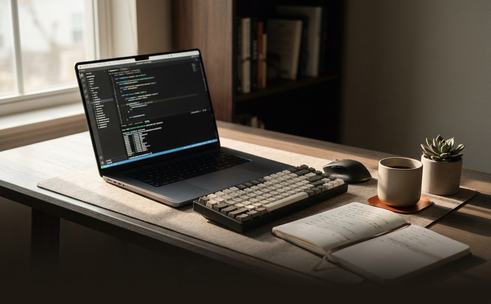
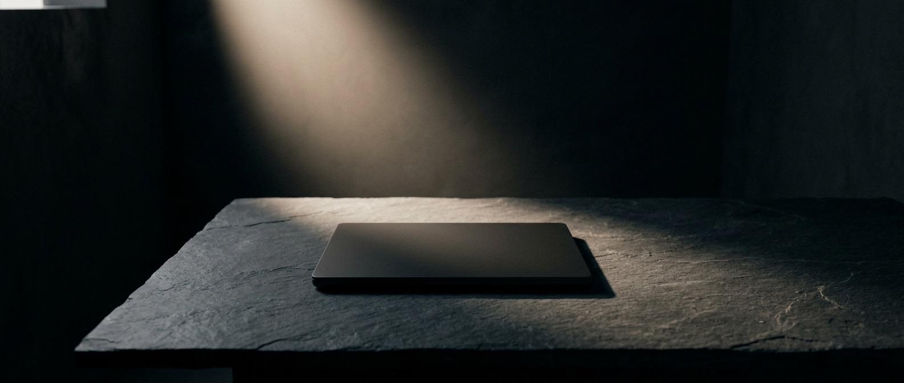

# Art for the picsum placeholders

Both images are now in place as `.jpeg` files and are wired to local files **with
picsum as an automatic fallback**, so nothing breaks if a file is missing.

| File | Where it appears | Actual size | Aspect |
|---|---|---|---|
| `site/workbench.jpeg` | hero, right column (replaces the old fake div editor) | 1312 x 816 | ~16:10 |
| `site/privacy-band.jpeg` | full-bleed band above the privacy statement | 1584 x 672 | ~2.36:1 (wide) |

Both were re-encoded to ~170-195 KB with `sips -s formatOptions 80`.

Both images are rendered in the page through `filter: grayscale(1) contrast(1.05)
sepia(.16)`, so they turn into a warm monochrome. You do **not** need to
desaturate them yourself; just make sure the composition has good light/dark
separation and does not rely on color to read.

---

## Prompt 1 - `workbench.jpg`

> Editorial product photograph, shot on a full-frame camera with a 35mm lens.
> A tidy developer's desk in warm morning light: an open laptop showing a code
> editor with a terminal pane, a mechanical keyboard, a paper notebook with
> handwritten notes, a matte ceramic coffee cup, and a small plant. Soft
> directional window light from the left, gentle long shadows, shallow depth of
> field. Muted, desaturated palette of warm bone, beige and deep brown with a
> single small copper-orange accent object. Natural film grain. No text, no
> readable code, no logos, no watermark, no faces. Calm, premium, tactile mood.
> Keep the main subject in the upper two-thirds of the frame (the lower third is
> covered by a gradient and a caption). Aspect ratio 16:10.

## Prompt 2 - `privacy-band.jpg`

> Ultra-wide cinematic photograph, 21:9. A quiet, minimal scene about privacy
> and a self-contained machine: a closed matte laptop (or a matte, sealed object)
> resting on a large, empty dark stone or concrete surface in a dark room, lit by
> a single soft beam of light. Generous negative space on the left and right for
> text to sit over. No people, no text, no logos, no glowing screens. Deep
> near-black background, warm bone highlights, subtle film grain, low contrast in
> the shadows. Restrained, premium, editorial mood.

---

## How to wire it (already done, for reference)

```html
<!-- hero, right column -->
<figure class="hero-shot">
  
</figure>

<!-- privacy band -->

```

Notes:
- The hero image is rendered through `filter: grayscale(1) contrast(1.05)
  sepia(.16)`, turning it into warm monochrome to match the rest of the page.
- `onerror` swaps to the picsum placeholder only if the local file is missing,
  so the page never shows a broken image.
- Compress each to roughly 300-500 KB (JPEG, quality ~80). The `privacy-band`
  is cropped by `object-fit: cover`, so keep the subject centered and leave
  margin at the edges.
- Gemini image output is already sRGB, so no color-profile conversion is needed.

The bento card "It can touch your workspace" no longer uses a photo; it is a
design-native cell with tool tags now (the workbench shot moved to the hero).
